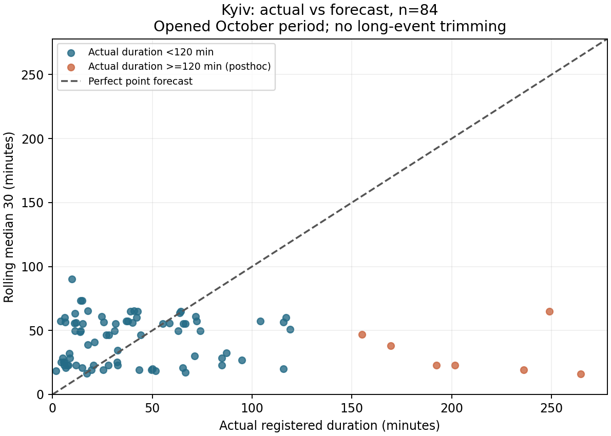
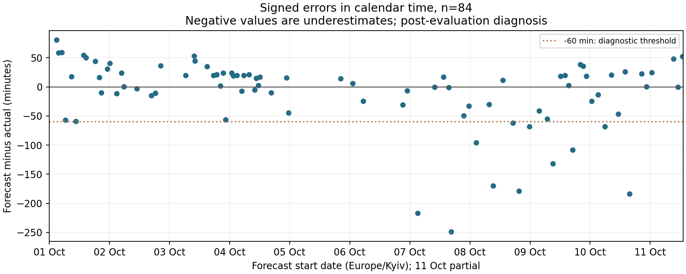
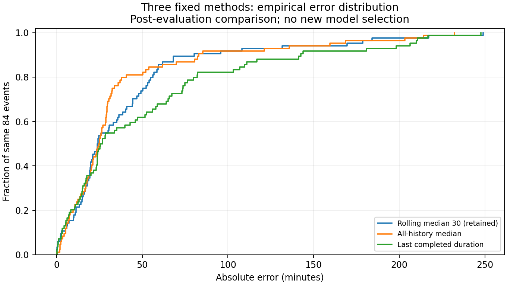

# Незалежний технічний ML-аудит, 12.10.2026

Початковий локальний commit: 7b24b5f. Перевірено фактичні файли, hashes, код, saved predictions, CV/scalers/model artifacts, bootstrap replicas, native AI export cutoffs. Попередні повідомлення агентів не прийнято як докази. Діагностичний план записано до нового порівняння трьох методів: audit/diagnostic-plan.json. Жовтень уже відкритий; весь додатковий аналіз має статус **після оцінювання**, а не незалежного тесту. raw, старі outputs і протоколи збережено. Зміни коду — окрема implementation-v2; point method rolling30 не змінено.

## Вердикт

**Постановка:** статистична ціль однозначна й придатна для малого дослідницького проєкту. Практичний користувач, рішення і втрати не перевірені. Фактичне переривання діяльності не вимірюється. MAE є послідовною дослідницькою метрикою медіани за симетричної абсолютної втрати; бізнес-оптимальність не доведена.

**Дані:** 240 конкретних Kyiv records мають достатню структурну якість для умовного closed-event replay (UTC, 0 duplicates/conflicts/overlaps, додатні інтервали). Повнота календаря, усі початки/відкриті події та availability of historical row versions не встановлені. Результати умовні щодо реєстрації, закриття й обробки в пізнішому архіві.

**Експеримент:** числова причинність features/history підтверджена в наявних впорядкованих прикладах; training-only CV/scaling перевірені. Це event-clock retrospective, не доведена оперативна симуляція доступного тоді payload. Стара валідація використовувалася повторно; CI є умовними й approximate. Обидва фінальні періоди вже використані.

**Прогноз:** розумний простий reference, але його перевага не переноситься автоматично між джерелами. У новій posthoc когорті historical median має нижчу MAE. Rolling30 лишається зафіксованим, не оголошується універсальним переможцем. Великі недооцінки та відсутність PI суттєві; практично прийнятної якості не встановлено.

**Реалізація:** старий валідний pinned run відтворюється. Знайдено latent unordered-state leak, empty-output/demo crashes та відсутність target-free inference API. Default v2 виправляє ці межі без зміни 84 числових прогнозів. Мінімальний supplied-history API працює; live ingestion/version availability/production deployment не доведені й не є вимогою мініпроєкту.

## Числові діагностики відкритого жовтня

| Метод | n | MAE | RMSE | Медіана AE | p90 AE | ±15 | ±30 | ±60 |
|---|---:|---:|---:|---:|---:|---:|---:|---:|
| median_last_30_completed | 84 | 40.894 | 62.620 | 24.008 | 76.708 | 25.0% | 54.8% | 85.7% |
| historical_median | 84 | 37.826 | 60.339 | 24.865 | 82.647 | 27.4% | 69.0% | 84.5% |
| last_completed_alert | 84 | 53.408 | 79.831 | 26.149 | 142.111 | 29.8% | 54.8% | 67.9% |

84 однакові події, без вилучення довгих. ±15/30/60 — задані діагностичні межі, **не погоджені acceptance thresholds**. MAE rolling30−historical = +3.068 хв, rolling30−last = −12.514 хв. Новий переможець не обраний. Порівняння обумовлене цією вже відкритою когортою.

Rolling30: mean signed error −10.909 хв, median signed error +4.179, 37 недооцінок та 47 завищень. Негативне середнє походить переважно від хвоста; воно саме по собі не означає неправильну оцінку медіани. 22/84 (26.2%) недооцінок >30 хв, 11/84 (13.1%) >60 хв із середнім shortfall 139.265 хв, 6/84 (7.1%) >120 хв. Максимальна недооцінка 248.829 хв. Десять найбільших помилок із датою, фактом і прогнозом збережені в [попередньому незмінному звіті](../reports/latest-duration-results.md); перші — 248.829, 217.067 та 184.017 хв. Long >=120: n=7, усі недооцінені, 70.6% SSE; MAE [120,240) 161.010 (n=5), >=240 216.423 (n=2). Ці малі групи — опис, не стабільна оцінка майбутнього ризику.

Календарні дні: MAE 17.580 (02.10, n=8), 80.876 (07.10, n=7), 87.905 (08.10, n=7); 05.10 має n=1. Дві неповні тижневі групи: n=42/42, MAE 27.939/53.849, mean signed +14.165/−35.983. **Тільки дві weekly clusters**: нового переконливого bootstrap CI для latest не надаємо. Event-lag correlations описові; lag 4 signed-error correlation ≈0.418 не є формальним shift/dependence test і не є 4-денним ACF.

У межах одного нового джерела September n=156: mean duration 77.265, median 35.705, p90 197.774, >=120 n=32. October n=84: mean 52.802, median 32.655, p90 116.644, >=120 n=7. Це ознаки неоднорідності вибірок/хвоста, не доказ причини або стаціонарності. Stored red у October n=3, yellow n=81; час історичного присвоєння рівня невідомий. Групування за фактом тривалості недоступне для прогнозу при старті.

Графіки мають повний хвіст і source/window/n; не є PI, дані не обрізано. Повні компактні таблиці — reports/ml-diagnostics/.

## Як обрано метод та що означають старі CI

Vadimkin, Kyiv city key, до 01.01.2026 навчання 1819 закритих подій (1789 після history warmup). Validation [01.01,01.07.2026): 277 однакових подій. Last: MAE/RMSE 55.865/97.761; historical median 35.578/68.573; rolling30 34.484/70.828; L1 median quantile regression 33.701/67.853. 15 ознак: cyclic hour/weekday, log gap after previous clear, last3 completed durations, medians last5/30/all, mean/std/q25/q75 last30. Відбої prior ≤ origin; current target не є ознакою; threat/media features відсутні.

Alpha grid .01/.1/1/5/10 перевірявся на чотирьох expanding temporal 2025 quarterly splits. Scalers fit лише past rows, outcomes завершені до fold fit cutoff; score outcomes перед fold end. У 511 score examples 2025 нуль виключень за crossing fold end (audit/cv-right-edge-check.json); правило все одно є outcome-conditioned при інших даних. Pooled n=511; minimum CV MAE 62.339 за alpha=.01. Coefficients/scaler після training frozen; validation не refit. Валідація була вже відома з v1: дизайн v2 exploratory, не незалежне підтвердження.

Rolling30−historical MAE −1.094 хв: 7d CI [−2.037,−0.255], 14d [−2.207,−0.213], але RMSE +2.255 хв. Model−rolling MAE −0.783 хв (~2.3%): 7d CI [−1.690,0.052], 14d [−1.587,0.001]. Model RMSE −2.975 хв. Правило promotion вимагало negative upper CI проти обох median для 7/14d та виграш у >=4/6 місяців; воно не виконане. Це пояснює консервативне утримання simple reference. **CI, що включає нуль, не доводить рівноцінність**; практична вартість менш ніж хвилини не визначена.

Bootstrap перевірено: matched 277 IDs, calendar clusters із partial edges, event-weighted numerator/denominator, 27 weekly/14 fortnightly nonempty blocks, 5000 draws; CI відповідають всім 30000 збереженим paired replicas. Блоки resample парно для методів; fraction(delta<0) не p-value. Обмінність і достатня незалежність blocks не доведені. Old rolling30 span median 20.126 дня (8.523–37.107), тому shared history може виходити за 7/14-day block. Такий span не є сам по собі доказом residual dependence, але обмежує гарантії CI. Період і нерівна експозиція partial blocks також важливі. No normality/stationarity requirement нав’язано.

Старий Vadimkin має явний UTC, але не має власних alert_id/alert_type: air_raid походить з опису набору, міський ключ — зі стабільної назви/рівня. Документація архіву описує перехід інших територій до районного рівня; для Києва рівень стабільний у training records, сталість policy/threat composition не доведено. Це інший процес реєстрації, ніж новий API mirror із UID/type/level; джерела не злиті.

Публічні aggregates із SHA/path provenance, frozen coefficients/scalers, 20 CV parameter sets і `scripts/replay_historical_selection.py` дозволяють повторити selected-model та baseline validation, training-only scaler і реконструювати 2555 CV predictions з pinned original CSV. У повному локальному проєкті безпосередньо зіставлено кожне з 1108 збережених validation predictions (277×4 methods) та 2555 quantile CV values. У clean public clone detailed outputs відсутні: там перевіряються відновлені агрегати й параметри, а не вдається, що звірено приватні per-event CSV. Моделі не refit, нові параметри не шукали; post-June target values не використано.

## Матриця критеріїв

Статуси: підтверджено / підтверджено частково / виявлено дефект / доказів немає / не застосовується. Для дефектів «числа незмінні» стосується вже збереженої валідної когорти, не обіцянки однакової поведінки на некоректних входах.

| Критерій | Статус | Доказ | Висновок | Дія | Вплив |
|---|---|---|---|---|---|
| Користувач і рішення | доказів немає | README до аудиту, відсутність user-study/SLA | Є практична гіпотеза планування, але немає підтвердженого користувача, ціни помилки або виміряного виграшу. | Описати гіпотезу; перед наступним тестом погодити рішення та втрати з користувачем. | Обмежує інтерпретацію; метрики незмінні. |
| Ціль, origin, одиниця | підтверджено | protocol/latest-v1.json; evaluation-predictions.csv | Одна зареєстрована закрита міська air_raid подія; повна тривалість у хвилинах при її початку. | Зберегти формулювання й явну умову відбору. | Документація. |
| Повна та залишкова тривалість | підтверджено частково | Старе демо; новий forecast.predict_at_start | Стара задача є повною тривалістю при старті; віднімання elapsed не є перевіреним прогнозом залишку. | README/методологія тепер розрізняють ці задачі; залишкова задача не реалізована. | Документація, без зміни цілі. |
| Тривога та переривання діяльності | доказів немає | Дані не містять фактичного припинення/відновлення роботи | Тривалість тривоги — лише можливий proxy; різні правила роботи під red/yellow. | Не заявляти виміряної тривалості переривання; потрібне user-study. | Обмежує практичний висновок. |
| MAE та асиметрична ціна | підтверджено частково | rolling median 30; docs/methodology.md | MAE узгоджена з медіаною за симетричної абсолютної втрати; реальна ціна завищення/заниження невідома. | MAE зберегти як дослідницьку метрику; бізнес-критерії погодити до нового тесту. | Інтерпретація, не новий вибір метрики. |
| Схема, UTC, пропуски полів | підтверджено | diagnostic-evidence.json; input SHA; 240 UID31 рядків | Явний UTC, позитивні закриті інтервали, необхідні поля наявні; відсутніх початків/відбоїв у цих 240 немає. | Явна schema validation у v2; не поширювати висновок на невідомі/незареєстровані події. | Числа незмінні. |
| Дублікати, конфлікти, перекриття | підтверджено | 240 унікальних API id, 0 перекриттів; frozen exclusions | У конкретному Київському знімку дефектів цих типів не виявлено. | У prediction API дублікати рахувати один раз, невідомі конфлікти/перекриття явно відхиляти. | Наявні результати незмінні; поведінка інших входів виправлена. |
| Територія, тип і рівень | підтверджено частково | mirror client UID31/UID14; group-errors.csv | UID31 є м. Київ, API type=oblast; UID14 — Київська область. air_raid усюди. Рівень — фінальне значення архіву, його значення при старті не доведено. | Не використовувати stored level як доведену початкову ознаку; групування тільки описове. | Обмежує інтерпретацію груп. |
| Джерела та зміна процесу | підтверджено частково | historical-input.json; source-distribution.csv | Vadimkin Telegram-derived та API mirror — різні процеси запису; у нового є red/yellow і API id. Джерела не злиті. | Порівняння метрик між джерелами не називати виграшем моделі або доказом стаціонарності. | Інтерпретація. |
| Closed-only selection та праве цензурування | підтверджено частково | select; кінці < snapshot boundary; 0 open Kyiv, 75 open всього | Когорта outcome-conditioned: закритість/відбій невідомі при старті. У наявних Kyiv рядках немає відкритих, але їхню відсутність у світі/джерелі не доведено. | Майбутнє дослідження: проспективно логувати всі початки та відкриті/цензуровані; не викидати їх без обліку. | Обмежує узагальнення на всі оголошення. |
| Відсутність подій vs спостереження | доказів немає | Порожній coverage registry; snapshot не має журналу безперервного отримання | Немає підстав для повних календарних днів чи нульового навантаження без рядків. | Не zero-fill; добову задачу тримати окремою. | Інтерпретація, поточні цілі не змінюються. |
| Event/publication/receipt/correction clocks | підтверджено частково | retrieval-log; mirror-version-history.json; CSV без updated_at | Event clocks явні; час отримання знімка записано. 7 archive commits тільки 06–11.10.2026; публікація/виправлення кожного рядка при історичному origin невідомі. | Використовувати термін event-clock retrospective; потрібні version/receipt logs для operational claim. | Суттєве обмеження ретроспективності. |
| Поточний відбій у прогнозі | підтверджено | Незалежні 210 прогнозів, новий API без поточного end | Поточна ціль входила лише до scoring; числового витоку її тривалості не виявлено. | Розділено predict_at_start і scoring. | Числа незмінні, API поліпшено. |
| Незавершена історія | підтверджено | verify_implementation_v2; end <= origin; tests | У збережених прикладах всі останні 30 закінчилися до прогнозу. | Зберегти as-of фільтр, окремо перевіряти доступність версії. | Числа незмінні. |
| Фільтрація за майбутнім | підтверджено частково | select всього closed cohort; новий target-free component | Статичний cohort відбирається за відбоєм/якістю після події. Це звужує оцінювану популяцію; checksum не доводить causal selection або publication-time availability. | Розрізнити retrospective cohort і as-of features; новий component ігнорує поточні/майбутні початки до end/target. | Інтерпретація; фактичних перекриттів/конфліктів у 240 немає. |
| Невпорядкований прямий виклик forecast helper | виявлено дефект | Відтворено 16 майбутніх відбоїв у старому стані при зворотному origin | Старий stateful helper не перевіряв порядок; production select був відсортований, тому старі 84 числа цим не зіпсовано. | Виправлено default implementation v2: кожний origin має окрему as-of історію, порядок rows не впливає. | Латентний витік на неправильному прямому вході усунуто; старі числа незмінні. |
| Незмінність після додавання майбутніх записів | підтверджено | test_forecast_api: future append, reversed rows, current target mutation | Тести числового прогнозу та lineage виконані без file-checksum gate. | Зберегти регресійні тести; корекції минулого без availability timestamps не можна віднести до часу. | Доказ алгоритмічної властивості, не якості прогнозу. |
| Scaling та CV leakage старої моделі | підтверджено | historical-cv-fit-checks.csv; raw frozen-model replay | 20 fold scalers заново звірено тільки з past fit rows; 1789-row final scaler та 2555 saved CV predictions відновлено з pinned raw. | Публікувати агрегати, параметри та replay helper; не перенавчати. | Числа старої моделі підтверджені. |
| Параметри та повторне використання валідації | підтверджено частково | v2 protocol; cv metrics; validation_reuse_limitation | Alpha=.01 за 2025 CV; 2026 validation уже була відома з v1, тому верифікація v2 exploratory. Rolling30 задано у збереженому v1 протоколі, який декларує locked_before_scoring; незалежного timestamp attestation цього старого протоколу немає. | Не називати це незалежним підтвердженням дизайну; новий untouched період для нових рішень. | Інтерпретація. |
| Оновлення історії всередині тесту | підтверджено | Протокол; lineage кожного прогнозу | Завершені попередні test events можуть входити до пізніших прогнозів; формула/параметри не переобираються. | Зберегти sequential scenario; не інтерпретувати як багатокроковий прогноз всього місяця в його перший день. | Документація. |
| Нерегулярний потік | підтверджено | Rolling30 spans; calendar grouping | 30 подій, не 30 днів: новий span 2.73–5.33 дня; old median span 20.13 дня. Origin заданий початком події. | Не робити daily autocorrelation із event lags; користуватися календарними розбиттями. | Документація. |
| Логіка вибору rolling30 | підтверджено частково | Historical metrics/CV/bootstrap; raw replay | На старій validation rolling30 менша MAE за historical на 1.094 хв, гірша RMSE на 2.255; модель виграла MAE 0.783 хв, CI включали нуль. | Залишити зафіксований метод; не називати альтернативи рівноцінними або rolling універсально кращим. | Уточнено висновок про силу переваги. |
| Публічні докази вибору | виявлено дефект | До аудиту GitHub мав лише новий runner і згадки старих результатів | Раніше читач не міг перевірити історичні цифри/CV/frozen coefficients. | Додано агреговані докази із SHA, 20 frozen CV models і stdlib raw replay, без raw redistribution. | Документація/відтворюваність, числа незмінні. |
| Додаткове latest порівняння | підтверджено | Наперед записаний audit plan; 84 paired examples | Historical median MAE 37.826 < rolling30 40.894; naive last 53.408. Це post-evaluation evidence, не новий blind test. | Не обирати нового фінального переможця; описати переносимість старого вибору як непідтверджену. | Змінився висновок про перевагу методу, не final method. |
| Помилки, групи й хвіст | підтверджено | diagnostic tables/3 plots | ±30: 46/84; >60 хв недооцінок: 11/84. Long >=120: 7 подій, усі недооцінені, 70.6% SSE. Red n=3 — замало для сильного висновку. | Групи за фактом тільки діагностичні; без trimming і без параметрів за ними. | Обмежує практичну корисність. |
| Bias, залежність, зміна розподілу | підтверджено частково | calendar/errors dependence/source distribution | Mean error -10.909, median +4.179; дві partial weeks мають mean +14.165 та -35.983. Не вимагали normality/стаціонарності. | Описувати часову неоднорідність і tail; ненульовий mean не є спростуванням median forecast. | Інтерпретація, без формального shift proof. |
| Bootstrap CI старих різниць | підтверджено частково | 277 matched IDs; 27/14 clusters; 5000 draws; saved 30000 replicates | Парність, event weighting та арифметика правильні. Незалежність/обмінність блоків не доведені; 7/14 днів коротші за можливу memory ~20 днів. | CI умовні й approximate; bootstrap fraction не p-value; latest 2 partial weeks без нового CI. | Статистична впевненість обмежена, не рівноцінність. |
| Прогнозні інтервали | доказів немає | Point API prediction_interval=null | Немає каліброваних інтервалів чи незалежної перевірки coverage. Range минулого не є PI. | Лише proposed-next-interval-study.json; не виконано, не погоджено, новий unseen період. | Обмежує оцінку невизначеності окремої події. |
| Порожні дані/мала історія/відсутнє демо | виявлено дефект | Old table([]) IndexError; old next() без default | Старий runner припускав наявність рядків/демо; pinned 240-case run не падав. | V2 має header-only CSV, null metrics при n=0, insufficient-history status та відсутнє демо без crash. | Старі числа незмінні; edge-case runtime виправлено. |
| Некоректні поля й недоступне джерело | підтверджено частково | schema tests; download failure/cache/checksum tests | Old downloader не підміняв вхід, але давав traceback; schema/internal API мали неявні припущення. | Контрольовані errors, atomic pinned download, verified cache; жодних fallback/null targets. | Runtime виправлено, числові результати незмінні. |
| Новий початок без майбутнього відбою | підтверджено частково | New predict command / forecast API | Тепер можна обчислити point forecast із нового start і supplied history. Підключення live source/історичної publication availability не доведено. | README явно називає source mode і gap; не приписувати можливість промисловому сервісу. | Функціональна прогалина закрита в мінімальному API. |
| Запізнення, корекції та forecast logs | підтверджено частково | Availability tests; output input/code SHA, history IDs/clears/durations | Якщо availability times передано, код їх дотримується; без них ретроспективні версії не можна датувати. | Логувати immutable input versions/issued forecasts; конфлікти без clocks — помилка. | Інтерпретація; старі snapshots не перезаписані. |
| AI-log і reflection | підтверджено частково | submission files; export manifest; 100-word reflection | Є справжні Codex text exports through cutoff; повних зовнішніх ChatGPT/Gemini/Antigravity експортів немає. Попередній closing watcher завершився timeout. | Оновити фактичні Codex records, позначити cutoff; власнику додати зовнішні full exports; без вигаданого closing transcript. | Прогалина подання, не ML-метрик. |
| Складні моделі/всі регіони/media/production | не застосовується | Наданий перелік KSE вимог | Ці складності не є обов’язковими; відсутність не є дефектом. | Не витрачати аудит на широкий пошук або зайву інфраструктуру. | Scope. |

## Виправлення та зміни висновків

Оригінальні duration.py (SHA f9331d07…), protocol/latest-v1.json, lock/opening, data/latest/results/, raw/v1/v2/Vadimkin final збережені. Default CLI тепер використовує forecast.py/evaluation.py, пише data/latest/implementation-v2/. Frozen reproduction доступна окремо, у scratch. V2 формує point forecast без нового end/target, незалежно від порядку rows, з перевіркою completed/version clocks; empty/short-history results мають null, не 0, header CSV і optional demo. Downloader має controlled errors, verified offline cache, atomic save. Actual input і forecast-code SHA та history IDs/clears/durations доступні в prediction log.

Незалежно перевірено 210 v2 forecasts, зокрема 84 evaluated; сім числових/lineage артефактів збігаються побайтово зі старими. 207 початкових raw/data/protocol/provenance/report файлів незмінні. **Числові фінальні результати не змінилися.** Змінилися можливості/захист API та висновок про силу переваги: вона на новому джерелі не підтверджена; historical median descriptively краща на відкритому жовтні, без нового final winner.

Чиста Git-копія commit 2ab1651 запущена в новому ізольованому CPython 3.14.7 venv (лише pip, без system-site packages). Pinned input отримано мережею, 40 змістовних runtime tests пройшли, default v2 / independent verifier / historical demo / target-free predict / stale-snapshot flag / legacy scratch replay виконані. Вісім posthoc CSV збігаються побайтово. Графіки окремо відтворено та візуально перевірено в documented Matplotlib 3.10.8 середовищі. [Clean-copy evidence](../reports/ml-diagnostics/clean-copy-verification.json). Ці перевірки доводять реалізацію й відтворення, а не прогнозну користь. Додатково нині звірено всі 219 файлів старого preservation protocol: жодної зміни.

## До подання та наступна ітерація

До KSE: подати робочий corrected runner з README/audit; додати повні зовнішні ChatGPT «Курування аналізу часових рядів» та всі використані Gemini/Antigravity експорти; завершити поточний native Codex export після його реального closing record; reflection має рівно 100 слів і факти роботи. Журнал рішень не замінює full texts. Не заявляти прийнятної практичної точності, live availability, повного календарного спостереження чи універсальної переваги rolling30. Складні моделі, всі регіони, media й industrial deployment не є умовою цього мініпроєкту.

Наступна дослідницька ітерація: user/cost elicitation; prospective immutable receipt/version logging і всі початки/відкриті події; новий untouched період; оцінювання interval recipe та coverage/width, а не range past durations. Proposal — audit/proposed-next-interval-study.json, **не погоджено й не виконано**. Можливі acceptance критерії до того тесту: min practical gain δ хв за погодженою loss, max частота/масштаб небезпечних недооцінок, point tolerance/p90, nominal PI coverage та корисна width, freshness/version auditability. Значення δ, ceilings і trade-offs має погодити користувач; нинішні ±15/30/60 не є SLA.

Методологічні джерела: [Hyndman & Athanasopoulos, point accuracy/time-series CV](https://otexts.com/fpp3/toolbox.html#scale-dependent-errors) (MAE ↔ median і past-only evaluation); [scikit-learn QuantileRegressor](https://scikit-learn.org/stable/modules/generated/sklearn.linear_model.QuantileRegressor.html) (median pinball loss, L1); [Barber et al., Conformal prediction beyond exchangeability](https://arxiv.org/abs/2202.13415) (не переносити exchangeable coverage guarantee на довільний dependent/shifted потік). Це не підтверджує якість нашого набору; фактичні докази вище локальні.
